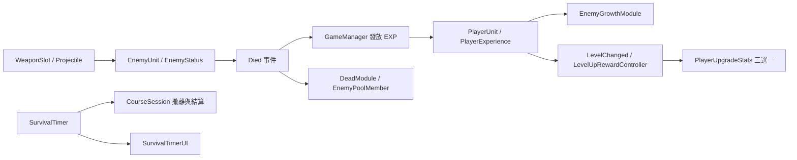

# 最後訊號 Last Signal

Unity 6 俯視角生存遊戲。玩家在無限延伸的基地中移動，武器自動攻擊附近敵人；透過擊殺獲取 EXP、升級武器並回復生命，生存滿 180 秒完成撤離。

本說明更新日期：2026-11-23。遊戲直接更新既有場景與 Prefab，主場景仍是 `LastSignal_v02.unity`。

GitHub：<https://github.com/ppyhalee26/Unity3DHW>。下載後由 Unity Hub 開啟倉庫根目錄；Library、Temp 等快取會由 Unity 自動建立。

## 開啟專案

| 項目 | 設定 |
| --- | --- |
| 專案資料夾 | `hw1012`（本 README 所在位置） |
| Unity Editor | `6000.6.2f1`（Unity 6.6） |
| 模板／渲染 | Universal 3D／URP 17.6.0 |
| 輸入 | Input System 1.20.0 |
| UI | uGUI 2.6.0，Canvas、Slider、Legacy Text，選單另使用 IMGUI |
| 主場景 | `Assets/CourseGame/Generated/LastSignal_v02.unity` |

1. 由 Unity Hub 開啟 `hw1012`，使用上述 Editor 版本。
2. 開啟主場景，或使用 **Course Game → Open Last Signal**。
3. 按 Unity 的 Play，點擊 Game 畫面，再按 Enter 或畫面上的「開始演練」。

`Assets/Scenes/SampleScene.unity` 與早期 `LastSignal_v01.unity` 保留供參考；目前的完整玩法請使用 v02。Build Settings 的第一個場景是 v02。

## 操作與目標

| 操作 | 功能 |
| --- | --- |
| WASD | 沿世界座標 XZ 平面移動，斜向速度不加倍 |
| Enter／Space | 開始演練；暫停時可繼續 |
| ESC | 暫停／繼續 |
| R | 演練中或結算後重新開始 |
| M | 開啟／關閉音效 |

武器自動選擇射程內最近的敵人，不需要手動瞄準或開火。注意閃避敵人與固定障礙物；子彈撞到障礙物也會回收。玩家生命歸零失敗，生存時間達到 180 秒勝利。結算後可再度挑戰。

## 遊戲規則

### 玩家、武器與 EXP

- 玩家生命上限 100，移動速度 5。
- 兩個武器槽環繞玩家，初始攻擊間隔分別為 0.46／0.58 秒。
- 投射物傷害 15、速度 18、射程 9.5，存活 1.6 秒後回池。
- 真正擊殺一隻敵人取得 1 EXP；敵人超出範圍或主動回收不發放 EXP。
- 首次升級需要 5 EXP；後續需求為 `ceil(前一級需求 × 1.1)`，未用完的 EXP 保留。
- 每次升級暫停戰鬥，必須在生命、投射物傷害、移動速度中選一項。已移除原本自動增加射速與回復 18 生命的規則。

### 11/23 新增：升級三選一

| 選項 | 預設效果 |
| --- | --- |
| 生命強化 | 最大生命 +20，目前生命 +20；保留原本受傷量 |
| 傷害強化 | 之後新發射的每發子彈傷害 +2 |
| 移動強化 | 玩家移速 +0.5 |

三個 Delta 位於玩家的 `PlayerUpgradeStats`，可在 Inspector 調整，允許重複選同一項。

- `PlayerUnit.LevelChanged` 對每個真正增加的等級各發送一次事件。
- 一次連升多級會累積待選次數，選完所有獎勵才恢復戰鬥。
- 視窗打開時 `Time.timeScale = 0`，敵人、子彈、物理與生存時間都停止；uGUI 按鈕仍可互動。
- 選完恢復打開視窗前的時間倍率，不一律寫死為 1。ESC／繼續操作不能跳過升級選擇。
- 手動暫停期間取得的獎勵會等到繼續戰鬥後再顯示。
- 死亡或撤離成功會清空待選、關閉浮層，並維持結果畫面的暫停。
- `WeaponSlot` 每次從池取得子彈後，設定「模板基礎傷害＋玩家 DamageBonus」。不修改 Prefab，不追溯修改已發射子彈，也不在回池重用時累加舊傷害。
- 沿用 `CourseSession` 作為戰鬥／暫停／結果控制，不額外重建教材中的 GamePhaseController。升級浮層開啟時仍處於 Playing 階段。

| 玩家等級 | 升下一級所需 EXP | 到達此級的累積 EXP |
| --- | ---: | ---: |
| 1 | 5 | 0 |
| 2 | 6 | 5 |
| 3 | 7 | 11 |
| 4 | 8 | 18 |
| 5 | 9 | 26 |
| 6 | 10 | 35 |
| 7 | 11 | 45 |
| 8 | 13 | 56 |

### 11/09 新增：敵人等級強化

`EnemyGrowthModule` 直接讀取玩家等級，依「血量 → 傷害 → 移速」輪流強化，每次升級只輪到其中一項。兩個敵人 Prefab 都掛有此元件；敵人物件池目前使用 `Enemy_v01.prefab`。

沿用本專案的基礎值：最大生命 30、接觸傷害 9、移速 2.55。教材示例中的傷害 10／速度 3 不是強制設定，本專案保留既有數值。

| 玩家等級 | 敵人最大生命 | 接觸傷害 | 移速 | 本次新增強化 |
| --- | ---: | ---: | ---: | --- |
| 1 | 30 | 9 | 2.55 | 初始 |
| 2 | 35 | 9 | 2.55 | 生命 |
| 3 | 35 | 10 | 2.55 | 傷害 |
| 4 | 35 | 10 | 2.75 | 移速 |
| 5 | 40 | 10 | 2.75 | 生命 |
| 7 | 40 | 11 | 2.95 | 移速 |
| 10 | 45 | 12 | 3.15 | 移速 |

計算方式：

```text
upgrades = max(0, 玩家等級 - 1)
cycles = upgrades / 3（整數除法）
remainder = upgrades % 3
healthCount = cycles + (remainder >= 1 ? 1 : 0)
damageCount = cycles + (remainder >= 2 ? 1 : 0)
speedCount = cycles

目前能力 = 基礎能力 + 對應次數 × 對應 Delta
```

Inspector 預設 `Health Delta = 5`、`Damage Delta = 1`、`Move Speed Delta = 0.2`，可各自設為 0。Play Mode 修改 Delta 會重新套用目前等級。

基礎值在敵人的 Awake 快取；修改 Prefab 基礎能力後，請重新進入 Play Mode 以建立新基準。Delta 則可在 Play Mode 即時調整。

已在場上的敵人升級時，更新最大生命、傷害及速度，**不回復現有生命**。敵人重新出池時，先依目前等級計算，再由既有 `EnemyPoolMember.Activate()` 回滿新的最大生命。能力從首次快取的基礎值重新計算，因此不會因同一物件反覆回收而疊加。

### 11/09 新增：生存計時器

- `SurvivalTimer` 保存本局經過的遊戲秒數，使用 `Time.deltaTime` 累積。
- 本場景設 `Auto Start = false`，由 `CourseSession.StartRun()` 呼叫 `Begin()`；開始畫面固定為 00:00。
- 暫停時 `Time.timeScale = 0`，時間不增加；繼續時接著原時間累積。
- 玩家死亡或成功撤離會停止計時、保留結果，並只發送一次 `TimerStopped` 事件。
- `SurvivalTimerUI` 只負責讀取秒數，以 Legacy Text 顯示 `MM:SS`；整數秒未變更時不重寫文字。例如 205 秒顯示 03:25。
- 上方的「存活時間」與「撤離倒數」共用同一個 `SurvivalTimer`。`CourseSession.Elapsed` 讀取此計時器，不再另行累積第二份時間。
- 重新開始會重新載入場景，生命、EXP、等級、敵人池及計時器一併重置。

這是受暫停與時間倍率影響的遊戲時間，不是電腦時鐘或真實經過時間。

### 生成、地板與障礙物

- 每 30 秒提升生成頻率與場上上限。演練開始時每 0.9 秒生成 2 隻；90 秒後改為每批 3 隻。生成間隔最低 0.28 秒，場上上限最高 30 隻。
- 敵人池預建 30、容量上限 40；投射物池依模板區分，各預建 24、各最多 80。
- 地板邊長 12，內圈半徑 2（5×5）供鏡頭與敵人生成使用，額外預載 1 圈（總共 7×7、49 塊）。
- 內圈以外的預載地板不擴大敵人的戰鬥區域。
- 障礙物有補給箱 `SupplyCrate`、路障 `Barricade`、訊號柱 `SignalPillar` 三種。
- 每個地板節點同時顯示一種障礙物，依世界格子、清單順序及固定種子決定種類、位置與旋轉。保留重疊格子，回到已離開的格子時仍能重建一致配置。
- 每個節點按種類快取最多三個實例，不隨旅行距離持續新增地板；敵人出生點避開障礙物。
- 敵人沿用 Rigidbody 直接追蹤，不包含繞障礙物尋路。

## 程式架構



| 模組 | 主要職責 |
| --- | --- |
| `PlayerMovement` | Input System、CharacterController、重力與接地 |
| `PlayerStatus`／`PlayerUnit` | 玩家生命、對外數值入口、死亡事件 |
| `PlayerExperience` | EXP、等級、每級門檻 |
| `PlayerUpgradeStats` | 三種獎勵 Delta、玩家屬性加成與 DamageBonus |
| `LevelUpRewardController` | 待選佇列、三個按鈕、暫停恢復及 Game Over 優先處理 |
| `EnemyStatus`／`EnemyUnit` | 敵人生命、傷害入口、死亡事件 |
| `EnemyMovement`／`EnemyAttackModule` | Rigidbody 追蹤、接觸傷害與冷卻，提供速度／傷害設定接口 |
| `EnemyGrowthModule` | 基礎能力快取、輪流成長、依等級重新計算 |
| `WeaponSlotController`／`WeaponSlot` | 武器槽排列、最近目標搜尋、透過子彈池發射 |
| `Projectile`／`ProjectilePool` | 碰撞傷害、障礙物阻擋、壽命與多模板池 |
| `EnemyPool`／`EnemyPoolMember`／`EnemySpawner` | 敵人預建、借出、回收、重設與生成位置 |
| `DeadModule`／`GameManager` | 死亡處理、敵人登記、真正擊殺才發 EXP、GameOverStarted 事件 |
| `InfiniteGroundController`／`GroundObstacleNode` | 世界格子、預載、地板重用與障礙物快取 |
| `PlayerMovementAnimation`／`EnemyMovementAnimation` | 依實際速度切換 Idle／Run、轉向 |
| `PlayerHUD`／`EnemyHealthUI` | 玩家 HP／EXP、敵人 World Space 血條 |
| `SurvivalTimer`／`SurvivalTimerUI` | 生存時間、停止事件與 MM:SS 文字 |
| `CourseSession`／`CourseHUD` | 選單、狀態、三分鐘勝敗、獎勵選擇回饋、聲音及其他 HUD |
| `CourseEnemyFeedback` | 擊殺統計與回饋，不另外發放 EXP |
| `CourseBuilder` | Editor 場景工具、既有場景整合、驗證指令橋接 |

## 主要檔案

```text
hw1012/
├─ README.md                         本專案說明
├─ Assets/
│  ├─ Art/                           原始教材模型、貼圖、動畫
│  ├─ Scripts/                       教材系統與 11/09 新元件
│  ├─ PlayerMovement.cs              玩家移動
│  ├─ WeaponSlot.cs                  自動索敵與發射
│  ├─ WeaponSlotController.cs        武器槽排列
│  ├─ Projectile.cs                  投射物傷害與回池
│  └─ CourseGame/
│     ├─ Scripts/                    遊戲狀態、HUD、回饋與驗證
│     ├─ Editor/CourseBuilder.cs     Editor 整合工具
│     ├─ SourceAnimations/           設定循環的教材動畫副本
│     └─ Generated/
│        ├─ LastSignal_v02.unity      目前主場景
│        ├─ Prefabs/                 Ground、Enemy、Projectile、障礙物
│        ├─ Materials/               專案材質
│        └─ Mesh_v01.controller      Idle／Run，無 Parameter／Transition
├─ Packages/manifest.json            套件版本
├─ ProjectSettings/                  專案與 Build Settings
├─ Documentation/                    原有操作說明、素材清單與歷史備份
└─ CourseGameVerification/           Play Mode 結果、狀態與畫面證據
```

根目錄 `Assets/` 與 `Assets/Scripts/` 中的腳本位置沿用既有配置，請勿重複匯入同名類別。角色 Animator 位於模型的骨架 `Root`，視覺縮放位於 Animator 外層，以避免動畫重寫模型比例。

## 教材來源與整合範圍

原始教材位於 `E:\嶺東作業\3D遊戲專案實務\上課教材`，本次沒有修改教材來源。

| 日期／教材 | 整合內容 |
| --- | --- |
| 20260907 ArtPack、20260914 | 原始角色／場景模型、3D 專案、WASD 移動與接地 |
| 20260917、20260921 | 武器槽、索敵、投射物、傷害、死亡 |
| 20261005 | 模型與 Idle／Run 動畫 |
| 20261012 | 敵人／投射物池、持續生成、跟隨鏡頭、無限地板 |
| 20261019、MultiPrefab_Obstacle_Lesson、Unity3D_HP_EXP | 障礙物預載、固定世界格子、HP／EXP／等級 UI |
| Unity6_3D_20261109.pptx／zip | 敵人輪流強化、Delta 參數、傷害／移速設定接口 |
| Unity6_3D_20261109Time.pptx／zip | 生存計時器、死亡停表、MM:SS 顯示、事件解耦 |
| Unity6_3D_20261123.pptx | 升級三選一、連升佇列、時間倍率恢復、傷害加成與結算優先 |

## 驗證與限制

本次 Unity Play Mode 檢查共 107 項通過、0 項失敗，涵蓋原有玩法、1～10 級敵人成長、物件池、計時，以及三選一按鈕、獨立加成、多級佇列、0.5 倍時間恢復、子彈傷害與死亡／勝利優先。另已用實際滑鼠點選傷害強化，確認面板關閉並恢復戰鬥。

測試證據：

- `CourseGameVerification/PlayMode-results-v02.txt`：本次功能與既有玩法回歸檢查。
- `CourseGameVerification/Verification-summary-v02.md`：驗證範圍與限制。
- `CourseGameVerification/Game-preview-v01.png`：既有遊戲畫面紀錄。

驗證在目前 Windows 電腦上的 Unity Editor Play Mode 進行。成長測試透過實際 `PlayerExperience` 加入 EXP 升級；勝利路徑採縮短目標時間測試，不能當成完整 180 秒的難度平衡驗收。`Endurance-v01.txt`／`Endurance-v02.txt` 是 10/12 的歷史三分鐘測試，不能代表本次擴充版已完成三分鐘耐久測試。

目前沒有在本次要求中輸出或驗證獨立執行檔、手機、手把或其他裝置。教材沒有配樂、專用攻擊／死亡動畫；目前使用簡短合成音效與 Idle／Run 動畫。

## 後續調整

- 敵人強化：修改敵人 Prefab 的 `EnemyGrowthModule` 三個 Delta；修改基礎值時調整 EnemyStatus、EnemyAttackModule、EnemyMovement 的原始欄位。
- 演練長度：修改場景 `CourseSession.Duration`；生存時間與撤離倒數會沿用同一計時來源。
- EXP 門檻：修改玩家 `PlayerExperience.First Level Requirement`。後續成長比例由 PlayerExperience 控制。
- 生成難度：調整 `EnemySpawner.SetDifficulty()`，與 EnemyGrowthModule 的能力成長分開。
- 升級選項：修改 `PlayerUpgradeStats`；場景接線由 **Course Game → Apply November 23 upgrade choices** 直接更新既有場景。
- 障礙物：修改 Ground Prefab 的 ObstacleNode 候選清單、種子與邊界距離。
- 重新接線：**Course Game → Apply November 9 lessons to current scene** 會直接更新目前主場景與敵人 Prefab，不另存新版本。**Build Last Signal v02** 會重新產生整個場景；一般場景美術調整後不要隨意執行重建。
